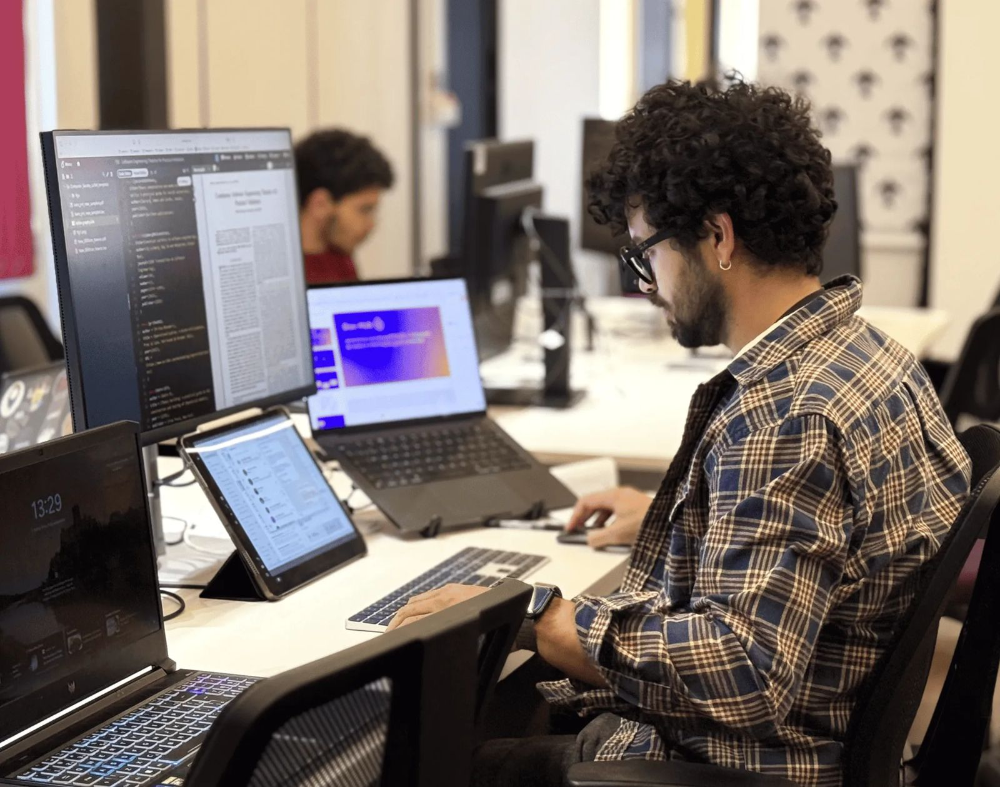

# Configurar o ambiente de desenvolvimento

> Tipo: **Tutorial**

<figure>
  
</figure>

## Para quem é

Para quem vai mexer com código e dados. A configuração é feita com a ajuda de alguém do time.

## Como fazer

1. Tenha acesso ao GitHub (tarefa anterior).
2. Combine com alguém do seu time um horário para configurar o ambiente juntos.
3. Dúvidas vão no tópico **Configuração de ambiente** do Telegram.

Quando terminar, clique em **Concluir e avançar**.
