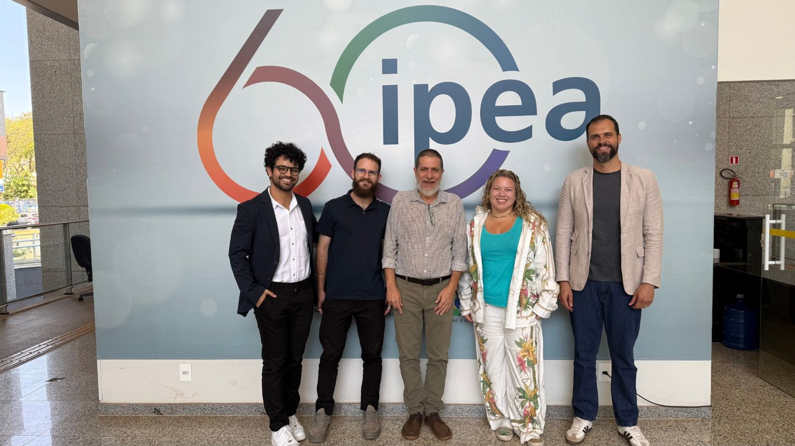
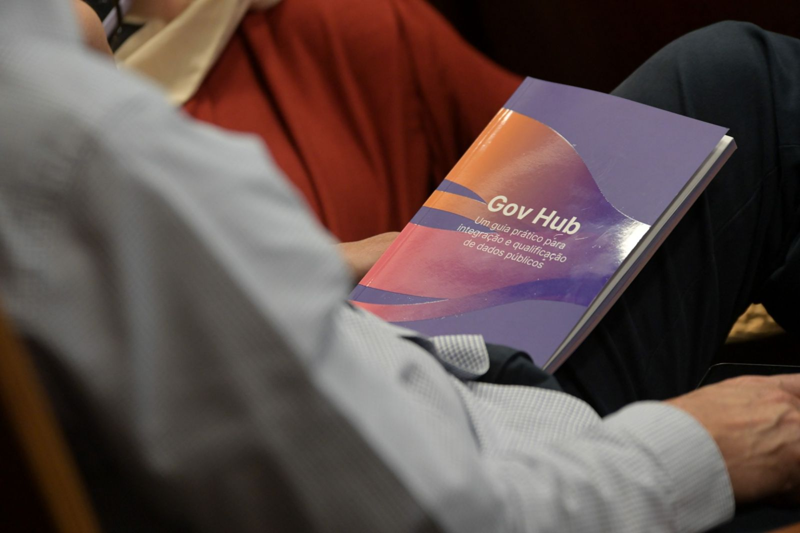

# De onde a gente vem e que problema resolve?

> Tipo: **Explicação**

## Origem

O Gov Hub é um projeto do **Lab Livre**, o Laboratório de Competência em Software Livre da
Universidade de Brasília (UnB), que trabalha de forma interdisciplinar com inovação, participação e
transparência a partir de tecnologias abertas.

O projeto nasceu em **2024**, da parceria entre o Instituto de Pesquisa Econômica Aplicada (**Ipea**) e
o Lab Livre, juntando ciência, inovação, pesquisa e serviço público.

> **Ciência aplicada. Código compartilhado. Impacto multiplicado.**

<figure>
  
</figure>

## O problema que a gente resolve

As informações do governo federal estão espalhadas em sistemas diferentes, e dados espalhados
dificultam decisões. A gente existe para fortalecer a capacidade do Estado de coordenar, gerir e
monitorar políticas públicas usando esses dados de forma integrada, com mais transparência e decisões
melhores.

O que a gente sonha é um país em que políticas e serviços públicos funcionem de forma mais justa,
efetiva e transparente, e em que as pessoas consigam compreender e influenciar as decisões do governo.

## Do dado espalhado à decisão

O Gov Hub é uma plataforma open source que funciona como uma camada de integração e qualificação de
dados. Informações que vivem em sistemas separados passam por quatro etapas nas nossas mãos:

1. **Integração**
2. **Padronização**
3. **Qualificação**
4. **Transformação**

No fim, viram insumos estratégicos para a gestão e para as políticas públicas.

<figure>
  
</figure>

## Para quem a gente trabalha

- **Servidores públicos**, de quem trabalha com os dados a quem toma decisões.
- **Pesquisadores.**
- **Jornalistas.**
- **Organizações da sociedade civil.**

Uns trabalham diretamente com os dados e sentem o impacto no dia a dia; outros usam os dados e os traduzem
para a população.

## Com que sistemas a gente trabalha

A plataforma centraliza, organiza e compartilha dados de diferentes sistemas do governo federal, como o
**SIAFI**, o **Compras.gov**, o **TransfereGov** e o **SIAPE**. Os dados brutos viram informação útil e
pronta para uso, com coleta automatizada, tratamento técnico e organização em camadas.

## Nossa arquitetura de dados

O **Apache Airflow** extrai os dados dos sistemas. No data warehouse, o **dbt** transforma esses dados
em camadas: o dado bruto (raw) é tratado (bronze), as bases são integradas (silver) e o resultado é
qualificado (gold). Do data warehouse, os dados seguem para a ciência de dados, os painéis, a governança e
os dados abertos. Tudo isso roda na **Astronomer**. Clique na imagem para ver em tamanho cheio.

[![Arquitetura de dados do Gov Hub, dentro de uma moldura que indica o ambiente Astronomer. À esquerda, na extração, os sistemas e bases de dados alimentam o Apache Airflow, que carrega os dados no data warehouse. No data warehouse, as tabelas Raw, Bronze, Silver e Gold ficam em sequência, e o dbt faz as transformações entre elas: tratamento (Raw para Bronze), integração das bases (Bronze para Silver) e qualificação (Silver para Gold). À direita, o data warehouse alimenta o consumo: ciência de dados e machine learning (Haystack), business intelligence (Apache Superset), governança de dados (OpenMetadata) e dados abertos (CKAN).](../../assets/diagramas/arquitetura-de-dados.png?v=2)](../../assets/diagramas/arquitetura-de-dados.png?v=2)

## Nossas três frentes

- **Infraestrutura pública de dados:** bases e fluxos de dados integrados, documentados e padronizados.
- **Transparência:** dados públicos organizados e visualizações acessíveis publicadas.
- **Cultura de dados:** processos permanentes de troca, escuta e aprendizagem entre os atores envolvidos.

Quando terminar, clique em **Concluir e avançar**.
