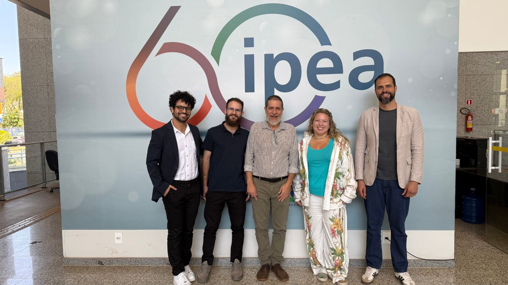

# De onde a gente vem e que problema resolve

> Tipo: **Explicação**

## Origem

O Gov Hub é um projeto do **Lab Livre**, o Laboratório de Competência em Software Livre da
Universidade de Brasília (UnB), que trabalha de forma interdisciplinar com inovação, participação e
transparência a partir de tecnologias abertas.

O projeto nasceu em **2024**, da parceria entre o Instituto de Pesquisa Econômica Aplicada (**Ipea**) e
o Lab Livre, juntando ciência, inovação, pesquisa e serviço público.

> **Ciência aplicada. Código compartilhado. Impacto multiplicado.**

<figure>
  
</figure>

## Que problema a gente resolve

As informações do governo federal estão espalhadas em sistemas diferentes, e dados espalhados
dificultam decisões. A gente existe para fortalecer a capacidade do Estado de coordenar, gerir e
monitorar políticas públicas usando esses dados de forma integrada, com mais transparência e decisões
melhores.

O que a gente sonha é um país em que políticas e serviços públicos funcionem de forma mais justa,
efetiva e transparente, e em que as pessoas consigam compreender e influenciar as decisões do governo.

## Do dado espalhado à decisão

O Gov Hub é uma plataforma open source que funciona como uma camada de integração e qualificação de
dados. Informações que vivem em sistemas separados passam por quatro etapas nas nossas mãos:

1. **Integradas**
2. **Padronizadas**
3. **Qualificadas**
4. **Transformadas**

No fim, viram insumos estratégicos para a gestão e para as políticas públicas.

<figure>
  
</figure>

## Nossas três frentes

- **Infraestrutura pública de dados:** bases e fluxos de dados integrados, documentados e padronizados.
- **Transparência:** dados públicos organizados e visualizações acessíveis publicadas.
- **Cultura de dados:** processos permanentes de troca, escuta e aprendizagem entre os atores envolvidos.

Quando terminar, clique em **Concluir e avançar**.
