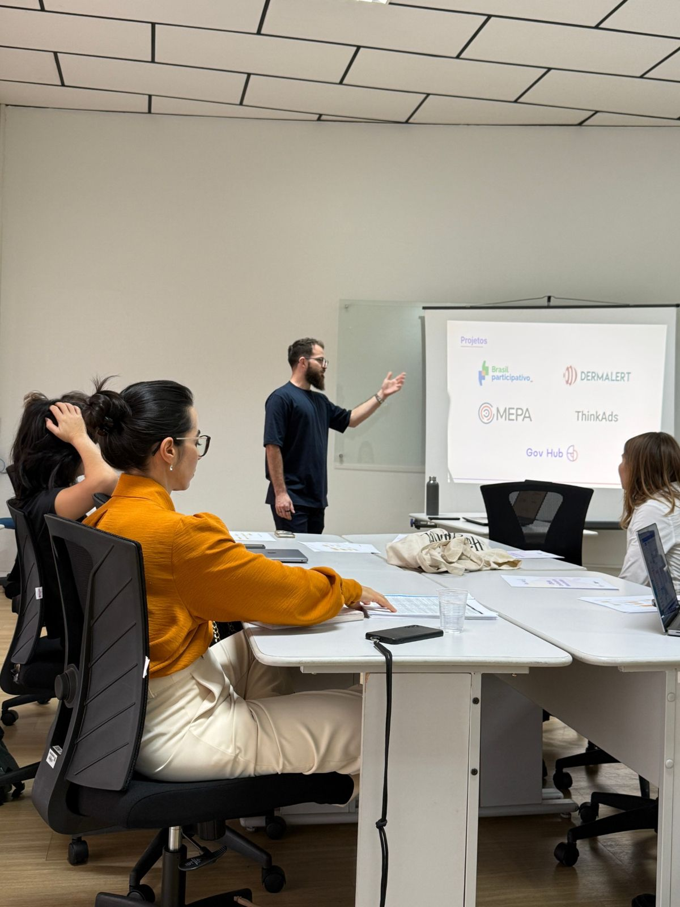

# Documento base dos projetos

> Tipo: **Referência**

<figure>
  
</figure>

## O que é

O **Documento base dos projetos** é a referência para os projetos do Gov Hub: o que cada projeto faz,
o escopo e como eles se organizam. Ele fica no Notion.

- [Abrir o Documento base dos projetos](https://app.notion.com/p/bp-ccsl/Documento-Base-dos-Projetos-3f830ee028a580489da5d925bb7e2280)

Quando terminar, clique em **Concluir e avançar**.
