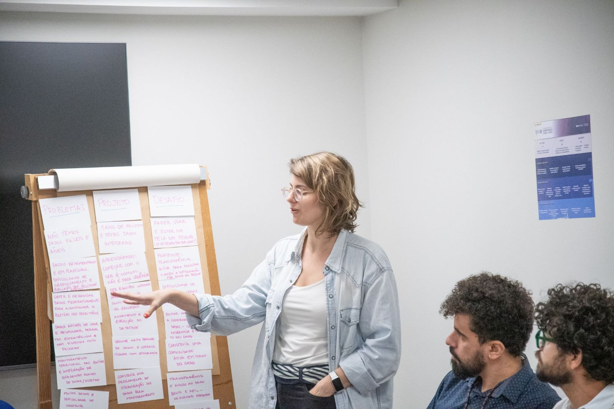

# Missão, visão e valores

> Tipo: **Explicação**

<figure>
  
</figure>

## Nossa missão

Fortalecer a capacidade do Estado de coordenar, gerir e monitorar políticas públicas a partir do uso
integrado de dados, aprimorando a transparência e a tomada de decisão.

## Nossa visão

Ser referência nacional em interoperabilidade no setor público, integrando dados fragmentados do
governo federal e promovendo transparência, confiabilidade e impacto social nas políticas públicas.

## Nossos valores

Transparência · Colaboração · Uso de código aberto · Impacto social · Ciência aplicada · Código
compartilhado

## O que nos faz diferentes

<figure>
  
</figure>

- **100% open source:** garante autonomia tecnológica, transparência e colaboração entre órgãos públicos.
- **Stack padrão do governo:** usa tecnologias já amplamente adotadas na administração pública, o que
  facilita adoção, manutenção e escalabilidade.
- **Flexível e reutilizável:** integrações feitas com sistemas estruturantes podem ser reaproveitadas
  por outros órgãos, reduzindo retrabalho e custos.
- **Interoperável:** conecta tanto com sistemas estruturantes quanto com os sistemas próprios de cada órgão.

Quando terminar, clique em **Concluir e avançar**.
