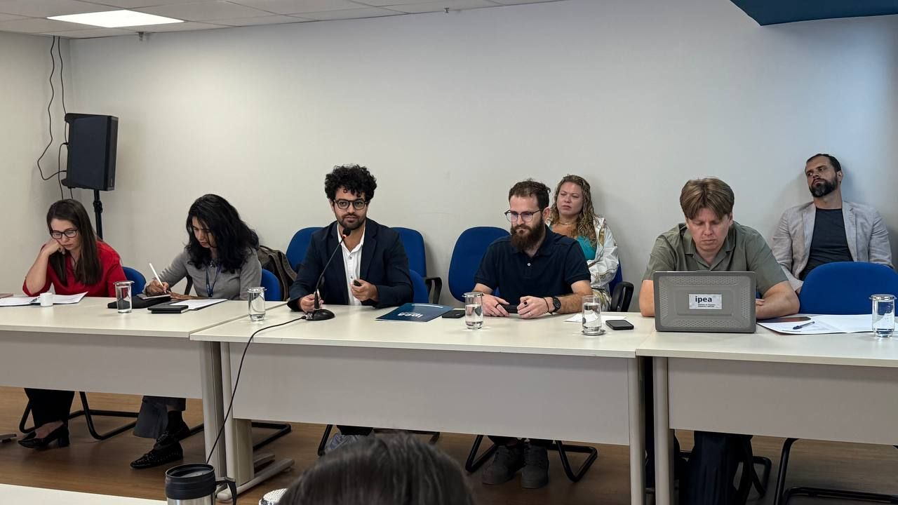
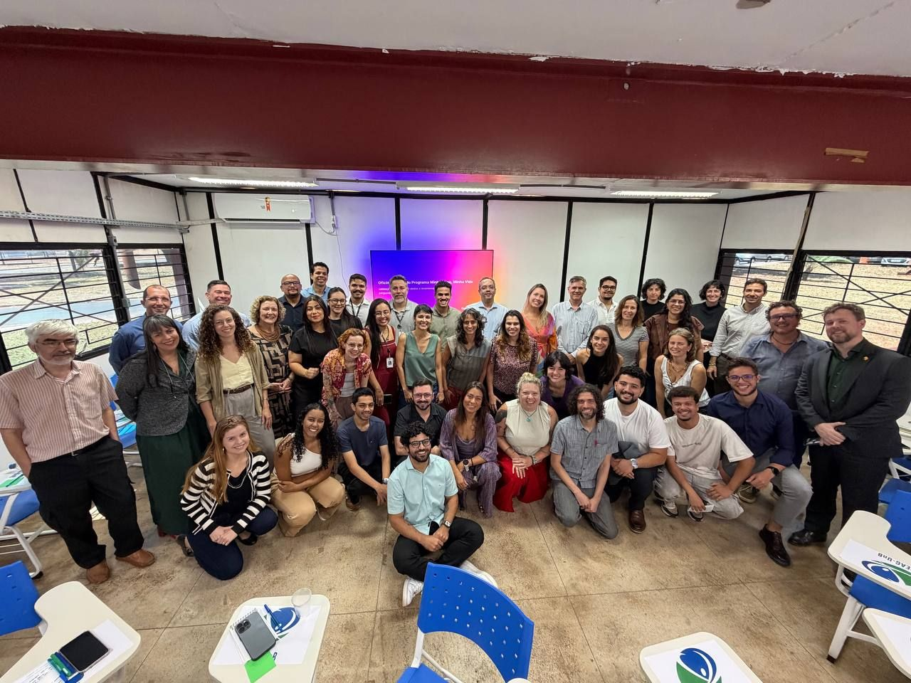
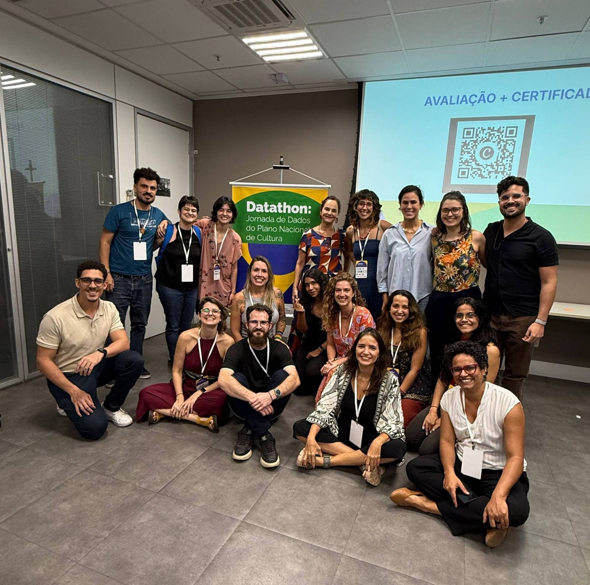

# Os cinco projetos com parceiros

> Tipo: **Explicação**

## Como funcionam as parcerias

Trabalhamos com órgãos do governo federal. Cada parceria vira um projeto, com escopo próprio de
integração e qualificação de dados. Você provavelmente vai atuar em pelo menos um deles.

<figure>
  
</figure>

## Os projetos

| Parceiro | O que o projeto faz |
|---|---|
| **Ipea** (Instituto de Pesquisa Econômica Aplicada) | Integrar e qualificar dados internos do Ipea e difundir o Gov Hub. |
| **MIR** (Ministério da Igualdade Racial) | Integrar e qualificar dados de acompanhamento das políticas do Ministério. |
| **MCid** (Ministério das Cidades) | Integrar e qualificar dados do programa Minha Casa, Minha Vida. |
| **MinC** (Ministério da Cultura) | Integrar diferentes fontes de dados para monitorar o Plano Nacional de Cultura e ações de participação. |
| **MGI** (Ministério da Gestão e da Inovação) | Integrar e qualificar dados orçamentários do Observatório de Contratações Públicas, com uso de IA e RAG para transparência ativa. |

<figure>
  
</figure>

<figure>
  
</figure>

Quando terminar, clique em **Concluir e avançar**.
