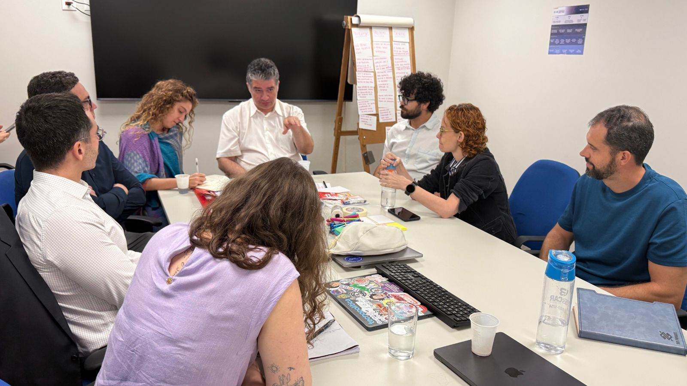

# Conhecer a fundo o seu projeto

> Tipo: **Guia**

<figure>
  
</figure>

## Por que isso importa

Você já sabe em qual projeto vai atuar. Agora é hora de conhecer bem o escopo, as entregas e as pessoas
de referência dele.

## Como fazer

1. Leia a página do seu projeto no Notion: [Abrir os projetos](https://app.notion.com/p/bp-ccsl/Parcerias-2e830ee028a580979585eea017d6e358).
2. Navegue pela pasta do seu projeto no [Drive](https://drive.google.com/drive/u/0/folders/1DOUyTLNXfkj27HjIKotOkBhdZtlpaCGH).
3. Se você mexe com código e dados, abra os repositórios do projeto no [GitHub](https://github.com/GovHub-br).

Quando terminar, clique em **Concluir e avançar**.
