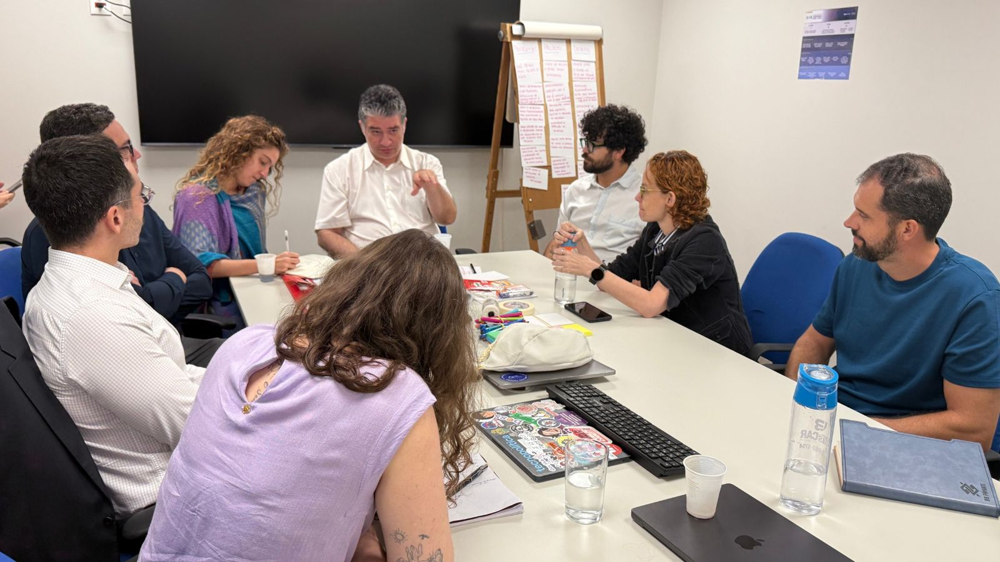

# Saber em qual projeto você vai atuar

> Tipo: **Guia**

<figure>
  
</figure>

## Por que isso importa

Cada projeto tem o seu tópico no Telegram, o seu escopo e as suas pessoas de referência. Saber onde
você vai atuar ajuda a escolher o que acompanhar desde o primeiro dia.

## Como fazer

1. Releia a tarefa **Os cinco projetos com parceiros**.
2. Combine com a liderança do seu time em qual projeto (ou projetos) você vai atuar.
3. Anote o nome do projeto: você vai usá-lo para seguir os tópicos certos no Telegram.

Quando terminar, clique em **Concluir e avançar**.
